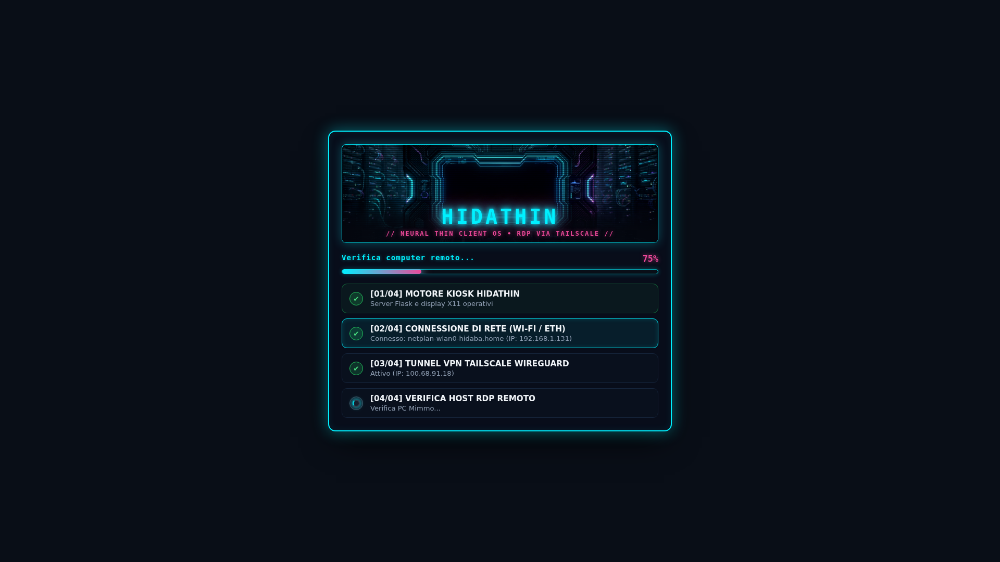
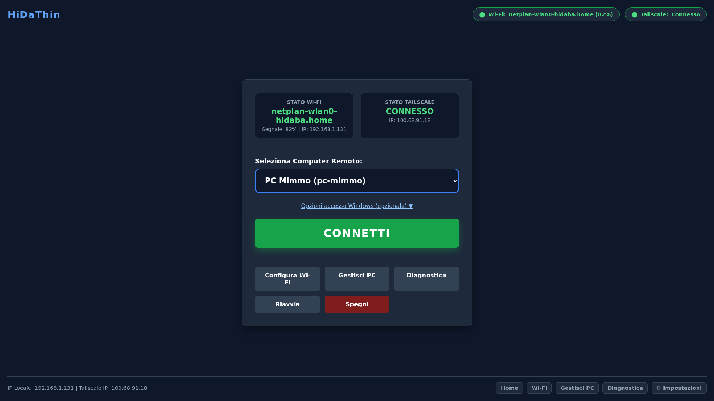

# HidaThin — High-Performance Raspberry Pi Thin Client for RDP via Tailscale

[](https://github.com/hidaba/HidaThin/releases)
[](https://opensource.org/licenses/Apache-2.0)
[](https://www.raspberrypi.com/)
[](https://www.raspberrypi.com/software/)
[](https://www.freerdp.com/)
[](https://tailscale.com/)
[](https://www.python.org/)
[](https://www.chromium.org/)
[](https://en.wikipedia.org/wiki/Virtual_Network_Computing)

**HidaThin** transforms a Raspberry Pi 3 Model B (or newer) into a dedicated, appliance-like, high-performance **Remote Desktop (RDP) Thin Client** connecting seamlessly over **Tailscale** WireGuard mesh networks and powered by **FreeRDP 3**.

---

## Visual Overview

### 🚀 Boot & Initialization Splash Screen
Cyberpunk-styled boot overlay featuring real-time readiness checks (backend UI, network interfaces, Tailscale WireGuard mesh, and remote RDP host reachability):



### 🖥️ Main Kiosk Connection Dashboard
Distraction-free, appliance-grade connection interface displaying live Wi-Fi and Tailscale status telemetry, target PC selector, and quick system controls:



---

## Key Features

- **Direct Kiosk Boot (Zero Desktop Overhead)**: Boots straight into a full-screen, responsive interface via Openbox and Chromium kiosk mode with no desktop environment bloat.
- **Ultra-Fast Startup (~14s to UI)**: Optimized bootstrap sequence decoupled from slow network negotiation, ensuring an instant cyberpunk-style splash screen and visual readiness feedback.
- **Native Tailscale Mesh VPN**: Automatic peer-to-peer WireGuard encrypted tunnels, MagicDNS hostname resolution, and zero firewall configuration.
- **Hardware-Optimized FreeRDP 3**: Fine-tuned for Broadcom VideoCore GPU and ARM Cortex-A53 (bitmap caching, H.264 offloading profiles, glyph cache, audio streaming, bidirectional clipboard).
- **Interactive Hot-Corner OSD Overlay**:
  - Native X11/Tkinter overlay staying strictly on top of full-screen FreeRDP (`DISPLAY=:0`).
  - Triggered by resting the mouse cursor in the top-left corner (`0, 0`) for 1 second.
  - Displays live network IP addresses (LAN, Wi-Fi SSID, Tailscale 100.x.x.x), active remote host name, and an immediate **Disconnect Session** button.
  - Auto-hides cleanly when moving the mouse away.
- **Zero-Latency Mouse Tracking**:
  - Hardware USB polling rate locked at 500 Hz (2 ms response time via `usbhid.mousepoll=2`).
  - Xorg libinput pointer configured with 1:1 linear `flat` profile—eliminating pointer sluggishness, smoothing lag, and deceleration curves.
- **Integrated Wi-Fi Management**: Built-in NetworkManager (`nmcli`) scanner and connection manager directly from the thin client screen, featuring automatic conflict cleanup and password preview.
- **Remote Assistance / VNC Desktop Shadowing**:
  - Integrated `x11vnc` service mirroring physical `DISPLAY :0` (allowing technicians to supervise both the Kiosk UI and active RDP sessions).
  - Can be bound exclusively to the Tailscale interface for total isolation from the local physical LAN.
  - Protected with encrypted VNC passwords and indicated with an on-screen "Remote Assistance Active" badge.
- **Resilient Systemd Services**: All backend, UI, and supervision daemons run under automatic watchdog supervision (`Restart=always`).

---

## Architecture

```text
 Raspberry Pi Boot
   │
   ├── systemd-timesyncd / NetworkManager (Wi-Fi & Ethernet)
   │
   ├── tailscaled.service (IP: 100.x.x.x, WireGuard, MagicDNS)
   │
   ├── cpu-governor.service (CPU scaling governor locked to 'performance')
   │
   ├── thinclient.service (Python 3 / Flask Backend on 127.0.0.1:8080)
   │
   ├── thinclient-ui.service (Xorg + Openbox + Chromium Kiosk on DISPLAY :0)
   │       │
   │       ├── Dashboard: Network status, Tailscale state, PC selector, CONNECT
   │       ├── Wi-Fi Manager (nmcli scanning & credentials management)
   │       ├── RDP Host Manager (CRUD for config/hosts.yaml)
   │       ├── Diagnostics (MagicDNS ping, RDP port 3389 probe, CPU, RAM, thermal throttling)
   │       └── Settings (Performance profiles, resolutions, VNC shadowing toggle)
   │               │
   │               └── CONNECT
   │                       │
   │                       ├── xfreerdp3 (FreeRDP 3.x with hardware caching)
   │                       │      │
   │                       │      └── Encrypted Tailscale WireGuard Tunnel
   │                       │             │
   │                       │             └── Remote Windows PC / Server (e.g. pc-work:3389)
   │                       │
   │                       └── overlay.py (Hot-Corner OSD Top-Left: Status & Disconnect)
   │
   └── thinclient-vnc.service (x11vnc mirroring physical :0 via Tailscale port 5900)
           │
           └── Remote Technical Support / Desktop Shadowing
```

---

## Hardware & OS Requirements

| Component | Minimum Requirement | Recommended |
|---|---|---|
| **Board** | Raspberry Pi 3 Model B | Raspberry Pi 3 Model B+, 4B, or 5 |
| **Power Supply** | Official 5V 2.5A micro-USB | Official Raspberry Pi Power Supply |
| **Storage** | 8 GB Class 10 MicroSD | 16 GB+ A1/A2 Class MicroSD |
| **Display** | 1080p (1920x1080) HDMI | HDMI with native EDID support |
| **Peripherals** | USB Keyboard & Mouse | Wired or low-interference 2.4GHz wireless |
| **Operating System** | Raspberry Pi OS Lite (64-bit or 32-bit Bookworm / Bullseye) | Raspberry Pi OS Lite 64-bit (Debian 12 Bookworm) |

---

## Installation & Setup

### ⚡ Quick Automated Install (Recommended)

Flash Raspberry Pi OS Lite (64-bit consigliato) sulla MicroSD, abilita SSH, connettiti al Raspberry Pi ed esegui il comando di installazione automatica:

```bash
curl -sSL https://raw.githubusercontent.com/hidaba/HidaThin/main/install.sh | sudo bash
```

Lo script si occupa automaticamente di:
- Aggiornare APT e installare tutti i pacchetti necessari (Xorg, Openbox, Chromium kiosk, Python 3, Flask, FreeRDP 3, VNC, NetworkManager).
- Installare e avviare Tailscale WireGuard Mesh.
- Distribuire il codice in `/opt/thinclient` con i corretti permessi.
- Configurare le ottimizzazioni hardware: CPU governor `performance`, accelerazione puntatore lineare (`flat` profile), polling mouse USB a 500 Hz, allocazione GPU a 128 MB e tuning swappiness.
- Applicare lo script di Fast-Boot per ridurre al minimo i tempi di avvio su MicroSD.
- Installare e avviare tutti i servizi systemd (`thinclient.service`, `thinclient-ui.service`, `thinclient-vnc.service`, `cpu-governor.service`).

Una volta terminato, autentica Tailscale e riavvia:
```bash
sudo tailscale up --accept-routes
sudo reboot
```

---

### Manual Installation & Step-by-Step Setup

Se preferisci eseguire l'installazione manualmente passo dopo passo:

#### 1. Base OS Preparation & Core Packages

Flash Raspberry Pi OS Lite onto your MicroSD card using Raspberry Pi Imager. Enable SSH and set your initial user credentials.

Boot the Raspberry Pi, connect via SSH, and install system dependencies:

```bash
sudo apt update && sudo apt upgrade -y

# Xorg, Openbox, and Chromium kiosk dependencies
sudo apt install -y xorg xinit openbox chromium-browser x11-xserver-utils xterm

# Python 3, Flask, YAML, and Tkinter (required for Hot-Corner OSD)
sudo apt install -y python3 python3-pip python3-flask python3-yaml python3-tk

# FreeRDP 3, VNC server, and Network tools
sudo apt install -y freerdp3-x11 x11vnc network-manager curl iproute2
```

### 2. Tailscale Installation & Authentication

Install Tailscale using the official automated script:

```bash
curl -fsSL https://tailscale.com/install.sh | sh
sudo tailscale up --accept-routes
```
Follow the URL printed in terminal to authenticate the Raspberry Pi to your Tailnet. Verify MagicDNS is active and note your device's 100.x.x.x IP.

### 3. Deploy HidaThin Codebase

Clone the repository directly into `/opt/thinclient`:

```bash
sudo git clone https://github.com/hidaba/HidaThin.git /opt/thinclient
sudo chown -R root:root /opt/thinclient
sudo chmod +x /opt/thinclient/scripts/*.sh /opt/thinclient/scripts/xinitrc
```

### 4. Hardware & Kernel Optimizations

#### A. Lock CPU Governor to `performance`
Prevent CPU frequency scaling lag on the ARM Cortex-A53 cores:
```bash
sudo cp /opt/thinclient/systemd/cpu-governor.service /etc/systemd/system/
sudo systemctl daemon-reload
sudo systemctl enable --now cpu-governor.service
```

#### B. GPU Memory Allocation
Ensure at least 128 MB of RAM is dedicated to the GPU for video buffering and FreeRDP bitmap caches.
Edit `/boot/firmware/config.txt` (or `/boot/config.txt` on older OS releases):
```ini
gpu_mem=128
```

#### C. Mouse Hardware Polling Rate (500 Hz)
Append `usbhid.mousepoll=2` to `/boot/firmware/cmdline.txt` on the same single line:
```text
console=serial0,115200 console=tty1 root=PARTUUID=... rootfstype=ext4 fsck.repair=yes rootwait usbhid.mousepoll=2
```

#### D. Xorg Linear Pointer Acceleration (`flat` profile)
Copy the optimized libinput Xorg configuration to eliminate pointer sluggishness and artificial smoothing:
```bash
sudo mkdir -p /etc/X11/xorg.conf.d
sudo cp /opt/thinclient/config/50-mouse.conf /etc/X11/xorg.conf.d/
```

#### E. Swappiness Tuning
Reduce disk writes to extend MicroSD longevity:
```bash
echo "vm.swappiness=10" | sudo tee -a /etc/sysctl.d/99-swappiness.conf
sudo sysctl -p /etc/sysctl.d/99-swappiness.conf
```

#### F. Fast Boot: Aggressive Systemd Pruning & Masking
Disable blocking background services, update timers, and non-essential hardware polling daemons (saves ~3-4s of boot time and eliminates MicroSD I/O congestion):
```bash
sudo bash /opt/thinclient/scripts/optimize-boot.sh
```
*(To revert at any time: `sudo bash /opt/thinclient/scripts/optimize-boot.sh --undo`)*

### 5. Configuration & Passwords

Edit `/opt/thinclient/config/hosts.yaml` to specify your target Windows machines (passwords are stored locally on the thin client with `0600` permissions and never sent to the browser or web frontend):

```yaml
version: 1
default_host: pc-work

hosts:
  pc-work:
    name: "Workstation Office"
    hostname: "pc-work"       # MagicDNS hostname or Tailscale IP (100.x.x.x)
    ip: "100.64.0.7"
    port: 3389

  pc-server:
    name: "CAD Server"
    hostname: "cad-server"
    ip: "100.64.0.9"
    port: 3389
    username: "operator"
```

Configure `/opt/thinclient/config/settings.yaml`:
```yaml
version: 1
profile: "balanced"          # performance | balanced | quality
resolution: "auto"           # auto | 1920x1080 | 1600x900 | 1280x720
color_depth: 24              # 16 | 24 | 32
sound: true
auto_reconnect: true
max_reconnect_retries: 3
fullscreen: true
vnc:
  enabled: true
  port: 5900
  bind_tailscale_only: true  # Strictly binds to Tailscale IP; refuses LAN fallback
web_admin:
  bind: "127.0.0.1"           # Localhost only by default; 0.0.0.0 for remote administration
  port: 8080
  remote_enabled: false       # Set true to allow remote administration
  admin_token: ""             # Secret token required for mutating remote API calls
startup:
  mode: "dashboard"           # 'dashboard' (kiosk UI) or 'direct_rdp' (instant FreeRDP)
  connect_timeout_seconds: 20
  max_initial_attempts: 1
  fallback_to_dashboard: true
```

Configure the VNC remote assistance password (required before starting VNC):
```bash
sudo x11vnc -storepasswd "YourSecurePassword" /opt/thinclient/config/x11vnc.pass
sudo chmod 600 /opt/thinclient/config/x11vnc.pass
```

### 6. Enable and Start Systemd Services

Install and activate all required services:

```bash
# Copy systemd unit files
sudo cp /opt/thinclient/systemd/*.service /etc/systemd/system/

# Reload systemd daemon
sudo systemctl daemon-reload

# Enable services to run on boot
sudo systemctl enable thinclient.service
sudo systemctl enable thinclient-ui.service
sudo systemctl enable thinclient-vnc.service

# Start the services immediately
sudo systemctl start thinclient.service
sudo systemctl start thinclient-ui.service
sudo systemctl start thinclient-vnc.service
```

---

## User & Operational Guide

### 1. Booting & Splash Screen
Upon powering on, the Raspberry Pi loads directly into the HidaThin kiosk. Within ~14 seconds, the boot overlay confirms:
- Backend UI server online.
- Network interface (Wi-Fi / Ethernet) bound.
- Tailscale WireGuard connection established.
- Target RDP hosts probed and reachable.

### 2. Connecting to a Remote Desktop
1. Select the desired destination from the drop-down menu or quick-pick list.
2. Click **CONNETTI** (or press `Enter`).
3. FreeRDP 3 launches full-screen (`/f`). Windows logon credentials can be entered directly on the Windows login screen or configured in `hosts.yaml`.

### 3. Hot-Corner OSD Overlay (Quick Disconnect & Info)
While inside a full-screen Windows RDP session:
- **Hover the mouse in the top-left corner (`0, 0`) for 1 second**.
- An unobtrusive OSD panel will appear, displaying:
  - Local Network IP and Wi-Fi SSID (or Ethernet status).
  - Tailscale 100.x.x.x VPN IP.
  - Active Remote PC Hostname.
  - **DISCONNETTI SESSIONE** button.
- Clicking **DISCONNETTI SESSIONE** immediately terminates the RDP session and restores the HidaThin dashboard. Moving the mouse away auto-closes the overlay after 2 seconds.

### 4. Wi-Fi Configuration
Navigate to the **Wi-Fi** tab from the top navigation bar:
- Scan for nearby 2.4 GHz and 5 GHz networks.
- Click on an SSID, enter the WPA2/WPA3 passphrase (use the eye icon 👁 to verify), and click **Connetti**.
- Corrupted or invalid NetworkManager profiles are automatically sanitized.

### 5. Read-Only Filesystem & Appliance Protection (Soluzione B)
To completely eliminate MicroSD card corruption caused by abrupt power loss:
```bash
sudo bash /opt/thinclient/scripts/setup-readonly-fs.sh
```
- **Read-Only Root & Boot**: Both `/` and `/boot/firmware` are mounted `ro`.
- **Persistent `/data`**: NetworkManager Wi-Fi profiles, Tailscale auth states, and HidaThin configurations are bind-mounted to `/data`.
- **RAM Disks (`tmpfs`)**: Temporary files and systemd logs are redirected to volatile RAM.

### 6. Seamless Debian OS Updates via Web UI
When running in Read-Only mode, system packages can be safely upgraded directly from **⚙ Impostazioni**:
- Click **⚡ Aggiorna Sistema Operativo (Debian)**.
- HidaThin temporarily unlocks the disk (`mount -o remount,rw /`), runs `apt update && apt dist-upgrade -y`, synchronizes physical storage (`sync`), and strictly relocks the filesystem back to **Read-Only (`ro`)** even if an error occurs.
- Follow progress live via the integrated terminal console and reboot upon completion.

### 5. Remote Assistance (VNC Desktop Shadowing)
Supervisors or IT support personnel can view and control the thin client display (both UI and RDP session):
- Connect any VNC client (e.g., *Remmina*, *TigerVNC*, *RealVNC Viewer*) to:
  ```text
  <tailscale-hostname>:5900  or  100.x.x.x:5900
  ```
- Enter the password configured in `/opt/thinclient/config/x11vnc.pass`.
- An on-screen status badge notifies the local user that remote assistance is active.

### 7. Diagnostics & System Health
Access the **Diagnostica** tab to inspect:
- Real-time MagicDNS latency and port 3389 reachability.
- RAM usage, CPU temperature, and load average.
- Undervoltage or thermal throttling alarms reported by the Raspberry Pi firmware.

### 8. Direct-to-RDP Mode
For dedicated fixed workstations, HidaThin can bypass Chromium Kiosk on boot and connect immediately to the default Windows PC:
- Edit `/opt/thinclient/config/settings.yaml` and set:
  ```yaml
  startup:
    mode: "direct_rdp"
    connect_timeout_seconds: 20
    fallback_to_dashboard: true
  ```
- At boot, the system waits for network and Tailscale, launches FreeRDP full-screen immediately.
- If the remote PC is unreachable, authentication fails, or the session is voluntarily disconnected, the system automatically opens the Dashboard Kiosk without looping.

### 9. Automated Test Suite
Run the regression test suite covering all 25 validation scenarios (T01 - T25):
```bash
python3 -m pytest tests/ -v
```

---

## Repository Structure

```text
/opt/thinclient/
├── install.sh           # Automated single-command setup script for Raspbian/Debian
├── app/
│   ├── main.py          # Flask REST API and HTTP route handlers
│   ├── rdp.py           # FreeRDP 3 session execution and process management
│   ├── overlay.py       # Native Tkinter Hot-Corner OSD microservice (:0)
│   ├── vnc.py           # x11vnc status probe, password manager, and service control
│   ├── wifi.py          # NetworkManager nmcli scanner and profile management
│   ├── tailscale.py     # Tailscale CLI status and MagicDNS monitoring
│   └── system.py        # CPU governor, thermal throttling, and system telemetry
├── config/
│   ├── 50-mouse.conf    # Xorg libinput linear flat mouse acceleration profile
│   ├── hosts.yaml       # Persistent target PC definitions
│   ├── settings.yaml    # RDP performance profiles and VNC preferences
│   └── thinclient.logrotate # Logrotate configuration for session logs
├── scripts/
│   ├── install.sh       # Wrapper for the root installer
│   ├── direct_rdp_coordinator.py # Direct-to-RDP coordinator and fallback manager
│   ├── optimize-boot.sh # Aggressive systemd service pruning for ultra-fast boot
│   ├── setup-readonly-fs.sh # Soluzione B: Read-Only root + persistent /data
│   ├── xinitrc          # X11 kiosk initialization (Openbox + Chromium)
│   └── x11vnc-start.sh  # x11vnc watchdog with strict Tailscale binding
├── tests/
│   ├── test_sec.py      # T01-T05: Security, credential isolation, and VNC tests
│   ├── test_fs_installer.py # T06-T10: Read-only logging, persistence, installer tests
│   ├── test_boot_status.py  # T11-T15: Boot splash speed, healthz, and state cache
│   ├── test_rdp_lifecycle.py # T16, T17, T24: RDP session lifecycle & direct RDP
│   ├── test_net_wifi.py # T18-T20: Tailscale cache, SSID parsing, profile preservation
│   └── test_updater_settings.py # T21-T23, T25: OS updater lock, remount & settings schema
├── static/
│   ├── css/style.css    # High-contrast, touch/mouse friendly dark theme
│   ├── img/             # Splash screen and branding assets
│   └── js/app.js        # UI client polling, state machine, and dialog modals
├── systemd/
│   ├── thinclient.service      # Backend Flask API service
│   ├── thinclient-ui.service   # Xorg Kiosk UI service (TTY1 / DISPLAY :0)
│   ├── thinclient-vnc.service  # Remote assistance VNC service
│   └── cpu-governor.service    # Boot-time CPU scaling governor optimizer
├── templates/
│   ├── base.html        # Shell layout with status badges and navigation
│   ├── index.html       # Primary connection screen
│   ├── wifi.html        # Wi-Fi network manager
│   ├── hosts.html       # Target host management
│   ├── settings.html    # Resolution, profiles, and VNC configuration
│   └── diagnostics.html # Hardware and connectivity diagnostic page
└── CHANGELOG.md         # Detailed chronological release history
```

---

## License

This project is licensed under the **Apache License 2.0** — see the [LICENSE](LICENSE) file for details.

Copyright (c) 2026 Massimo Balestrieri.
